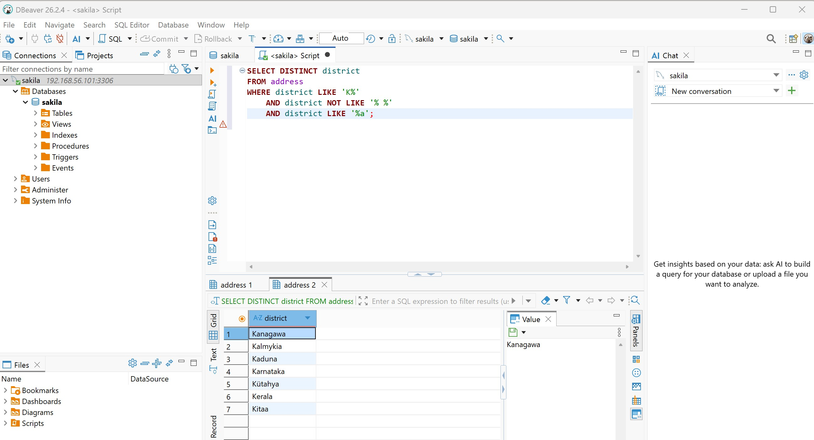
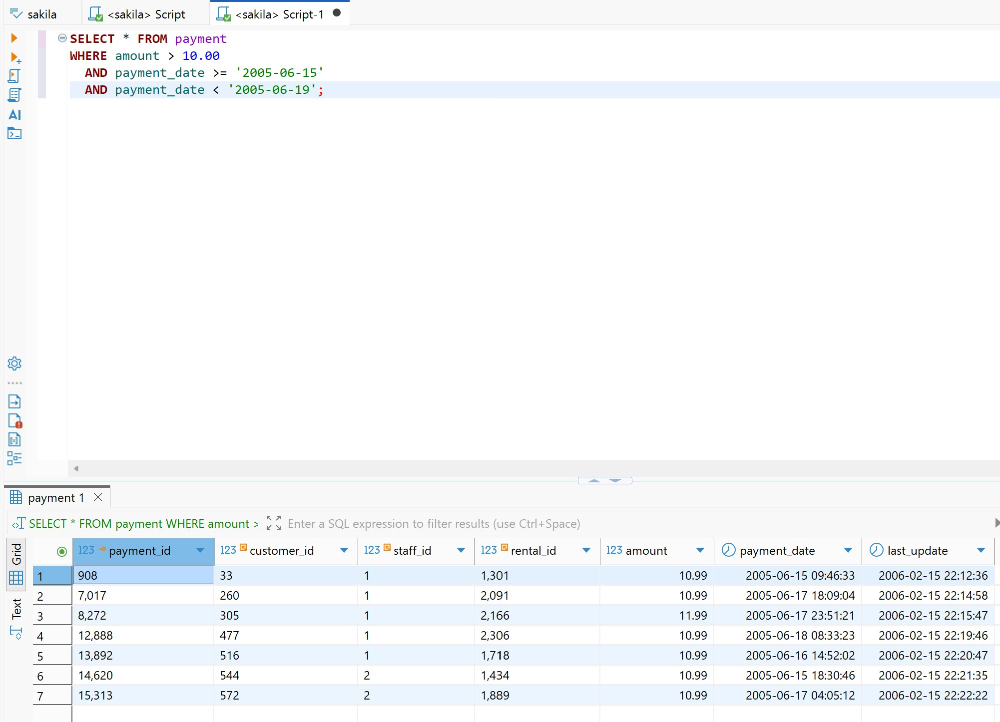
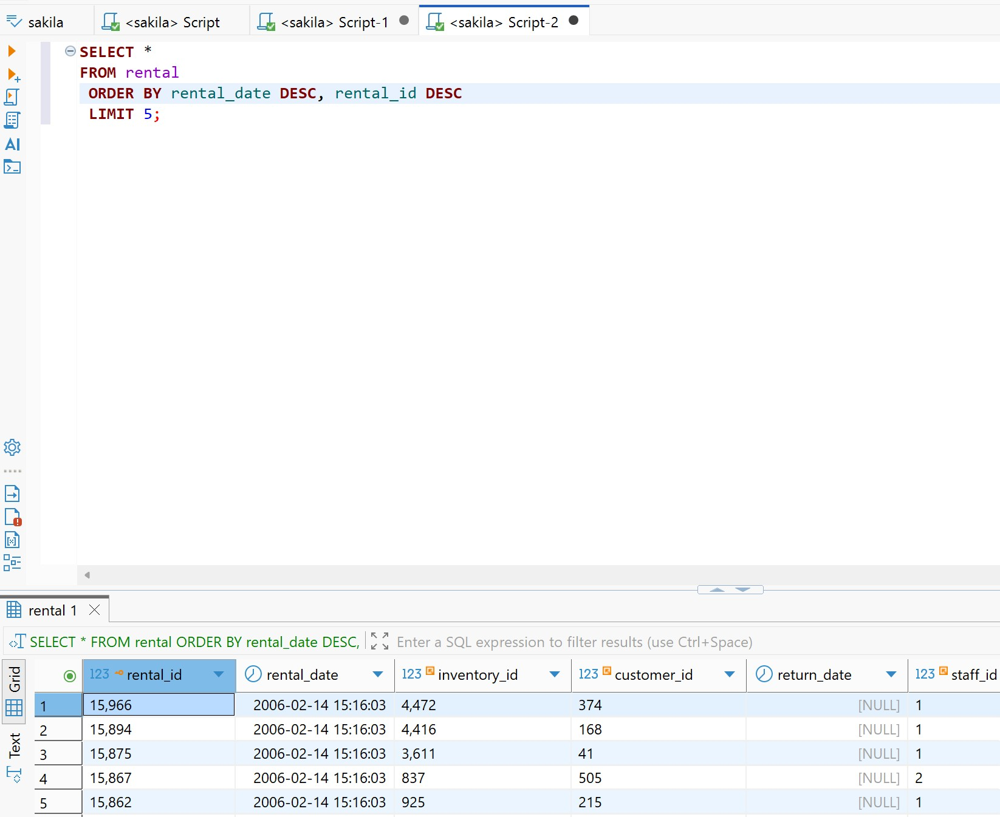

# Практическая работа — SQL-запросы в MySQL
# Антон Сап

## Задание 1.

Найти уникальные названия районов, начинающиеся на `K`, заканчивающиеся на `a` и не содержащие пробелов.

```sql
SELECT DISTINCT district
FROM address
WHERE district LIKE 'K%'
  AND district NOT LIKE '% %'
  AND district LIKE '%a';
```

**Результат:** 7 уникальных районов.



## Задание 2.

Получить платежи с 15 по 18 июня 2005 года включительно, сумма которых больше `10.00`.

```sql
SELECT *
FROM payment
WHERE amount > 10.00
  AND payment_date >= '2005-06-15'
  AND payment_date < '2005-06-19';
```

**Результат:** 7 платежей. Верхняя граница не включается, чтобы охватить весь день 18 июня с учётом времени.



## Задание 3.

```sql
SELECT *
FROM rental
ORDER BY rental_date DESC, rental_id DESC
LIMIT 5;
```

**Результат:** 5 последних аренд. Дополнительная сортировка по `rental_id` задаёт порядок записей с одинаковой датой и временем.


## Задание 4.

Вывести имена и фамилии в нижнем регистре, заменив в именах `ll` на `pp`.

```sql
SELECT
    REPLACE(LOWER(first_name), 'll', 'pp') AS first_name,
    LOWER(last_name) AS last_name
FROM customer
WHERE active = 1
  AND first_name IN ('Kelly', 'Willie');
```

**Результат:** 4 покупателя. Преобразования выполняются только при выводе и не изменяют исходные данные в таблице.

